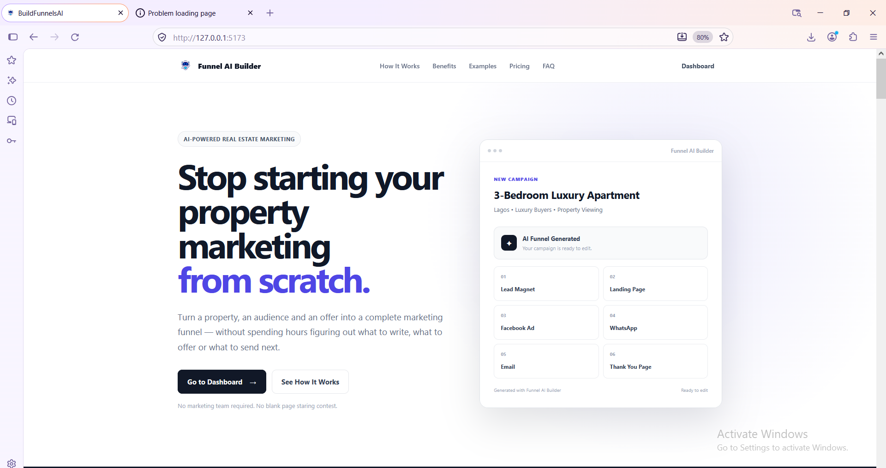
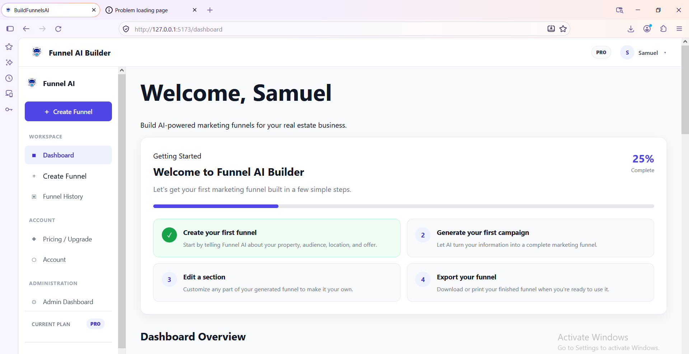
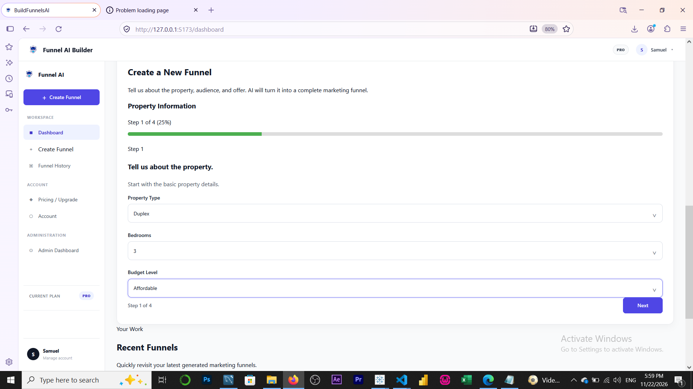
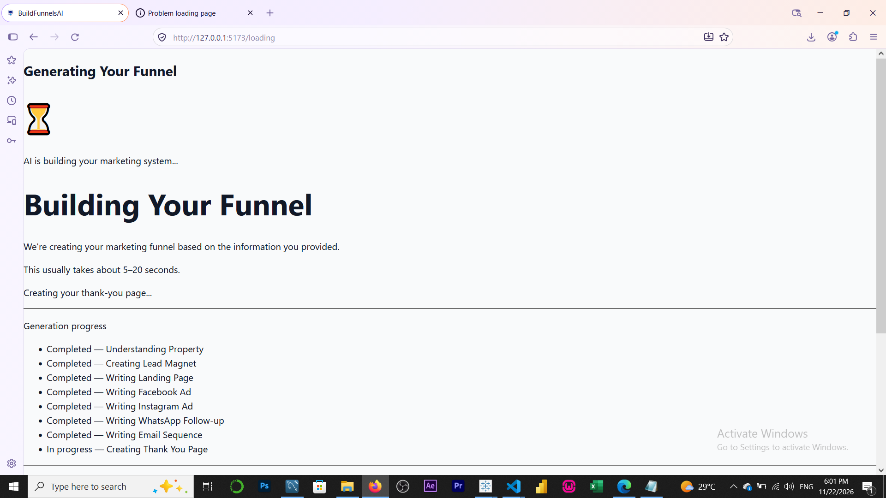
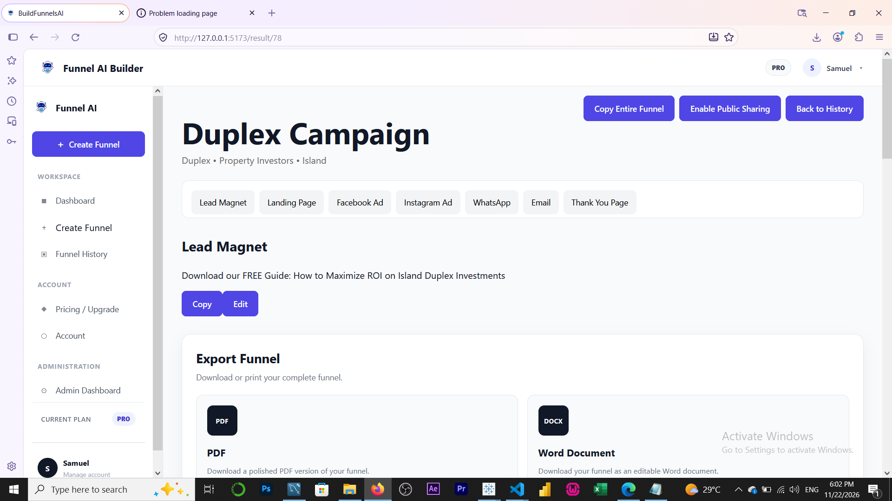
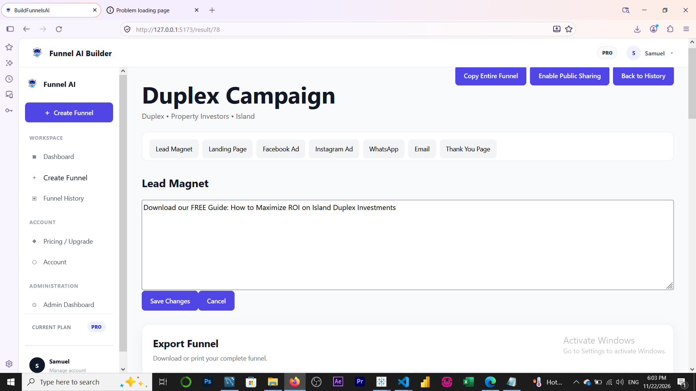
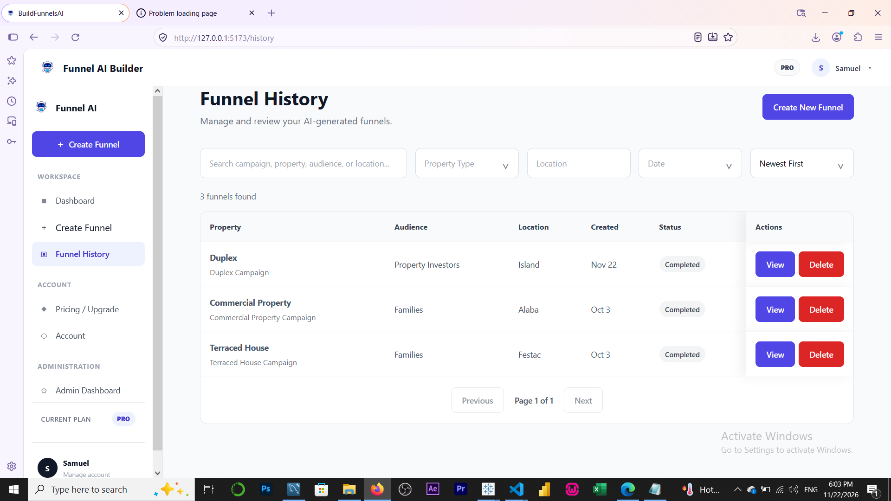
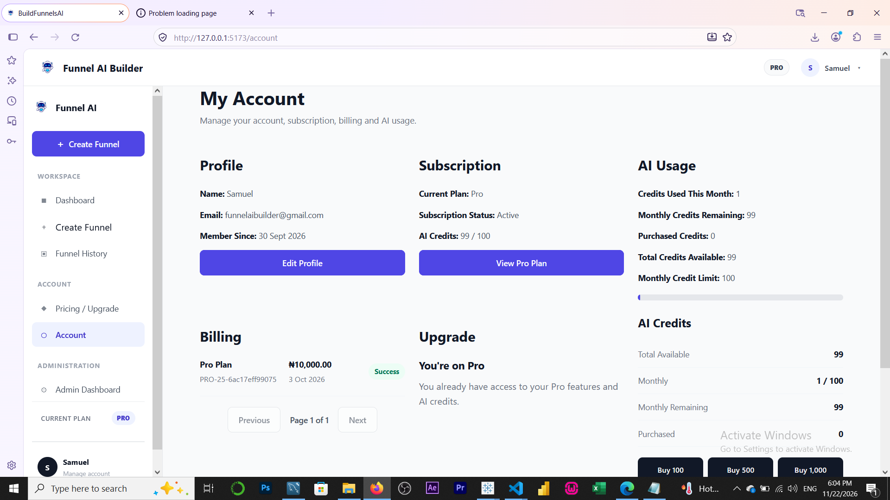

# BuildFunnelsAI — Frontend

**An AI-powered property marketing funnel builder for real estate professionals.**

BuildFunnelsAI helps real estate agents, brokers, property marketers, and agencies turn property information, target audiences, and marketing offers into structured marketing funnels.

The frontend provides the user interface for creating, managing, editing, sharing, and tracking marketing funnels.

---

## Project Overview

BuildFunnelsAI is an AI-powered web application designed to simplify the creation of marketing funnels for real estate professionals.

Marketing a property involves more than publishing pictures and descriptions. Real estate professionals need to communicate property value, identify suitable audiences, develop persuasive marketing messages, and organize their campaigns to attract potential buyers and enquiries.

Creating these materials manually can be time-consuming, particularly when managing multiple property listings.

BuildFunnelsAI addresses this challenge by using artificial intelligence to help users generate structured property marketing funnels from their property information and marketing requirements.

Rather than starting every campaign from scratch, users can generate, customize, manage, and share their marketing funnels through one application.

## Problem Statement

Real estate professionals often face challenges when creating marketing campaigns for individual property listings.

These challenges include:

- Spending considerable time developing marketing content for each property.
- Difficulty structuring property information into persuasive marketing campaigns.
- The need to create different marketing messages for different target audiences.
- Managing and updating multiple marketing funnels.
- Using separate tools for different stages of the marketing process.

## The Solution

BuildFunnelsAI brings these activities into one platform.

By integrating AI-powered content generation with funnel management and customization tools, the application helps real estate professionals streamline their property marketing workflow.

Users can provide property information and marketing requirements, generate funnel content, customize the results, save their work, and share funnels through public links.

## Application Screenshots

### 1. Landing Page

The public-facing page introduces BuildFunnelsAI and communicates its value proposition.



### 2. Dashboard

The dashboard provides users with an overview of their application activities and access to their marketing funnels.



### 3. Funnel Creation

Users provide property details and marketing information to initiate the funnel creation process.



### 4. AI Funnel Generation

The application processes the user's input to generate marketing funnel content using AI.



### 5. Generated Funnel

Users can view the marketing funnel generated from their submitted information.



### 6. Funnel Editor

Users can customize and refine generated funnel content.



### 7. Funnel History

Users can access previously created marketing funnels.



### 8. Account, Credits and Pricing

Users can access account-related features, AI credit information, and pricing options.



---

## Key Features

### Authentication and Account Management
- User registration and login.
- Protected application routes.
- Email verification.
- Forgot password and password reset.
- Account management.

### Funnel Management
- Dashboard for managing marketing funnels.
- AI-powered funnel generation.
- View generated funnel results.
- Funnel history.
- Funnel editing and section management.
- Compare previous funnel versions.
- Public funnel sharing.

### Marketing and Content Management
- Landing page editing.
- Editable funnel sections.
- Content regeneration.
- Printable funnel output.
- Public sharing links.

### Payments and Credits
- Pricing page.
- Payment verification.
- AI credit purchase verification.
- Credit-related user workflows.

### Administration
- Admin dashboard.
- Dashboard statistics and data visualisation.

### Analytics
- Product analytics using PostHog.
- User registration and login events.
- Funnel creation and editing events.
- AI generation events.
- AI credit usage and purchase events.
- Payment and plan upgrade events.
- Meta Pixel registration event tracking.

## Technology Stack

| Technology | Purpose |
|---|---|
| React 19 | Frontend user interface |
| Vite 7 | Development server and build tool |
| JavaScript (ES Modules) | Application logic |
| React Router 7 | Client-side routing |
| Axios | HTTP requests and API communication |
| Tailwind CSS 4 | Utility-first styling |
| Recharts 3 | Charts and data visualisation |
| PostHog | Product analytics |
| ESLint 9 | Code quality and linting |

## Project Structure

```text
funnel-ai/
│
├── public/
│
├── src/
│   ├── api/
│   │   └── axios.js
│   │
│   ├── assets/
│   │
│   ├── components/
│   │   ├── Button.jsx
│   │   ├── Card.jsx
│   │   ├── ProtectedRoute.jsx
│   │   ├── LandingPageEditor.jsx
│   │   ├── PrintableFunnel.jsx
│   │   └── ...
│   │
│   ├── context/
│   │   ├── AuthContext.jsx
│   │   ├── FunnelContext.jsx
│   │   └── ToastContext.jsx
│   │
│   ├── hooks/
│   │   └── useFunnels.jsx
│   │
│   ├── layouts/
│   │   └── DashboardLayout.jsx
│   │
│   ├── pages/
│   │   ├── Landing.jsx
│   │   ├── Register.jsx
│   │   ├── Login.jsx
│   │   ├── Dashboard.jsx
│   │   ├── FunnelResult.jsx
│   │   ├── FunnelHistory.jsx
│   │   ├── Account.jsx
│   │   ├── Pricing.jsx
│   │   └── ...
│   │
│   ├── utils/
│   │
│   ├── analytics.js
│   ├── App.jsx
│   ├── App.css
│   ├── index.css
│   └── main.jsx
│
├── docs/
│   └── screenshots/
│
├── index.html
├── package.json
├── package-lock.json
├── vite.config.js
└── README.md
```

## Application Routes

The application uses React Router for navigation.

| Route | Description | Access |
|---|---|---|
| `/` | Landing page | Public |
| `/register` | User registration | Public |
| `/login` | User login | Public |
| `/dashboard` | Main dashboard | Protected |
| `/loading` | Funnel generation/loading | Protected |
| `/result/:id` | Generated funnel results | Protected |
| `/history` | Funnel history | Protected |
| `/account` | Account settings | Protected |
| `/pricing` | Pricing plans | Protected |
| `/share/:share_token` | Shared funnel | Public |
| `/admin` | Administration dashboard | Protected |
| `/payment/verify` | Payment verification | Protected |
| `/credit-purchase/verify` | Credit purchase verification | Protected |
| `/forgot-password` | Password recovery | Public |
| `/reset-password` | Password reset | Public |
| `/email-verified` | Email verification result | Public |

## Getting Started

Follow these instructions to run the frontend locally.

### Prerequisites

Make sure you have the following installed:

- Node.js
- npm
- Git

### 1. Clone the Repository

```bash
git clone https://github.com/keviscope/buildfunnelsai-frontend.git
```

### 2. Navigate to the Project Directory

```bash
cd buildfunnelsai-frontend
```

### 3. Install Dependencies

```bash
npm install
```

### 4. Start the Development Server

```bash
npm run dev
```

Vite will start the development server and display a local URL, usually:

```text
http://localhost:5173
```

Open the URL in your browser.

**Backend connection:** The Axios configuration currently points to `https://api.buildfunnelsai.com`. API-dependent features require that backend API to be accessible. For a local Laravel backend, the API base URL must be configured to point to the local backend.

## Available Scripts

| Command | Description |
|---|---|
| `npm run dev` | Starts the development server |
| `npm run build` | Builds the application for production |
| `npm run preview` | Previews the production build locally |
| `npm run lint` | Runs ESLint checks |

### Create a Production Build

```bash
npm run build
```

Vite generates the production files in the `dist/` directory.

To preview the production build:

```bash
npm run preview
```

## Backend Integration

The frontend communicates with a separate Laravel backend through Axios.

**Backend repository:**

https://github.com/keviscope/funnel-ai-backend

The API communication layer is located at:

```text
src/api/axios.js
```

It handles:

- HTTP requests to the Laravel API.
- Laravel Sanctum session authentication.
- CSRF protection using XSRF cookies and headers.
- API response handling.
- Authentication and session errors.
- Network errors and request timeouts.
- Global error notifications.

The application uses credential-based requests to support session authentication.

## State Management

The application uses React Context API and custom hooks to manage shared application state.

Key files include:

- `AuthContext.jsx` — authentication-related state.
- `FunnelContext.jsx` — funnel-related context.
- `FunnelProvider.jsx` — funnel context provider.
- `ToastContext.jsx` — application notifications.
- `useFunnels.jsx` — custom funnel hook.

## Product Analytics

PostHog is used for product analytics and event tracking.

The analytics helper is located in:

```text
src/analytics.js
```

Tracked activities include:

- User registration and login.
- Funnel creation and editing.
- AI generation success and failure.
- AI credit usage and purchases.
- Payment completion and failure.
- Plan upgrades.
- Funnel exports.
- Public sharing activities.

The application also integrates with Meta Pixel for registration event tracking when the Pixel is available.

## Related Repository

**BuildFunnelsAI Backend**

The backend repository contains the Laravel API responsible for server-side application functionality, database operations, authentication, and other backend processes.

https://github.com/keviscope/funnel-ai-backend

## Development Notes

- The frontend and backend are maintained in separate repositories.
- API-dependent functionality requires a working backend connection.
- Never commit private API keys, passwords, authentication tokens, or production environment credentials.
- Keep environment-specific configuration and secrets out of public repositories.

## License

This project is proprietary. All rights reserved unless otherwise stated.