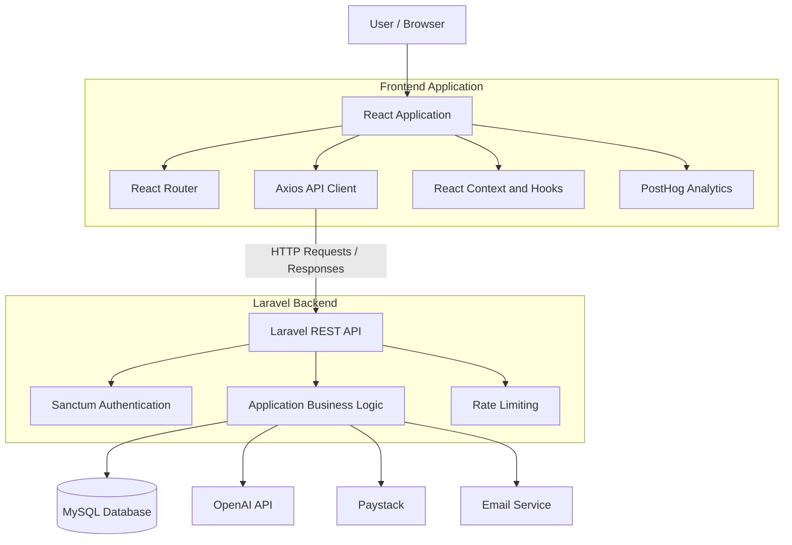
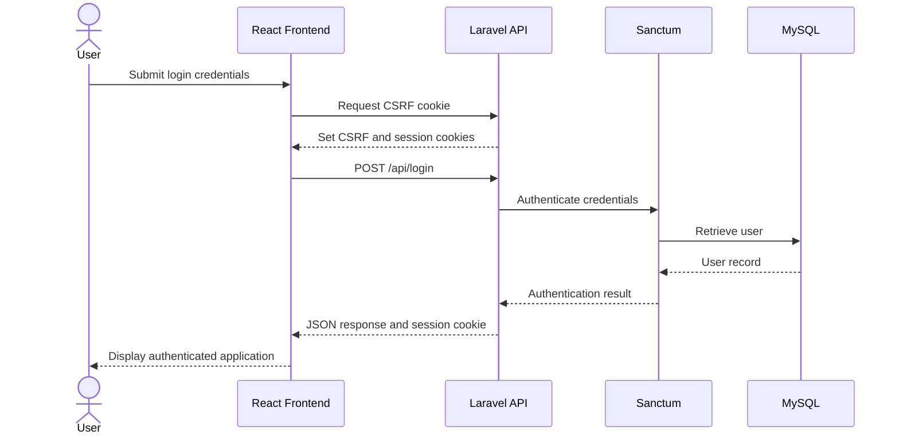
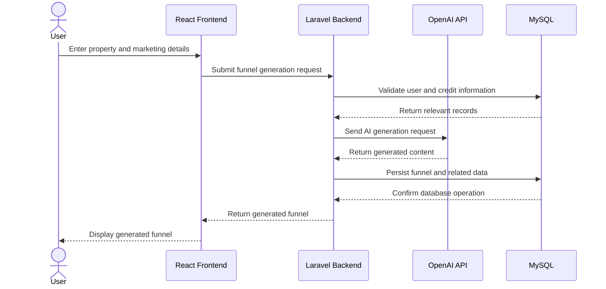
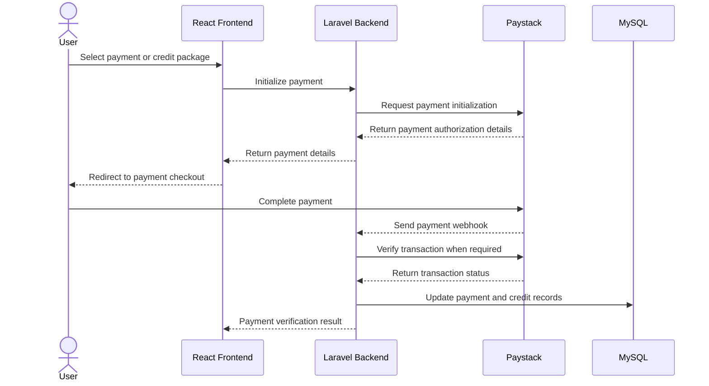

# BuildFunnelsAI — System Architecture

## 1. Overview

BuildFunnelsAI follows a frontend/backend architecture in which the client-side application communicates with a separate backend API.

The frontend is built with React and Vite, while the backend uses Laravel to handle application logic, authentication, database operations, AI integration, payment processing, and other server-side functionality.

MySQL is used for persistent application data storage.

The architecture separates presentation logic from backend business logic, allowing both applications to be maintained independently.

## 2. Technology Architecture

| Layer | Technology | Responsibility |
|---|---|---|
| Presentation | React 19 | User interface and interactive components |
| Build Tool | Vite 7 | Frontend development and production builds |
| Routing | React Router 7 | Client-side navigation |
| API Communication | Axios | HTTP communication with the backend |
| Backend | PHP / Laravel 12 | Application logic and REST API |
| Authentication | Laravel Sanctum | Session-based authentication |
| Database | MySQL | Persistent application data |
| AI Integration | OpenAI API | AI-powered funnel generation and content operations |
| Payment Integration | Paystack | Payment processing |
| Product Analytics | PostHog | Product usage and event tracking |
| Styling | Tailwind CSS 4 | Frontend styling |
| Data Visualization | Recharts 3 | Charts and dashboard visualizations |

## 3. High-Level System Architecture

The following diagram illustrates the major application components and their relationships.



## 4. Frontend Architecture

The frontend is responsible for presenting application features and managing user interactions.

### Main Responsibilities

- Rendering application pages and reusable components.
- Managing client-side navigation.
- Handling user input and form submissions.
- Managing shared application state.
- Communicating with backend API endpoints.
- Displaying API responses and errors.
- Tracking product events.

### Important Frontend Modules

| Module | Responsibility |
|---|---|
| `src/api/axios.js` | Centralized API client configuration |
| `src/App.jsx` | Application routes and route structure |
| `src/context/AuthContext.jsx` | Authentication state |
| `src/context/FunnelContext.jsx` | Funnel-related shared state |
| `src/context/ToastContext.jsx` | Application notifications |
| `src/hooks/useFunnels.jsx` | Funnel-related custom hook |
| `src/analytics.js` | Product analytics event tracking |
| `src/pages/` | Application pages |
| `src/components/` | Reusable interface components |

### Frontend Request Flow

1. A user interacts with a page or component.
2. The component triggers an application action.
3. Axios sends the appropriate HTTP request to the Laravel API.
4. The frontend receives the API response.
5. React updates the interface based on the response.

## 5. Backend Architecture

The backend is built with Laravel and provides the application's server-side functionality.

It exposes REST API endpoints consumed by the React frontend.

### Main Responsibilities

- User registration and authentication.
- Session and access management.
- Funnel creation and management.
- AI-powered content generation.
- Database operations.
- Payment initialization and verification.
- AI credit management.
- Funnel sharing.
- Analytics data processing.
- Administrative operations.

### API Structure

The backend API routes are organized around application features.

| API Area | Responsibilities |
|---|---|
| Authentication | Registration, login, logout and user profile |
| Funnels | Creation, retrieval, editing and deletion |
| AI | Funnel generation, regeneration and variations |
| Sharing | Public funnel access and sharing links |
| Credits | Credit balances, packages and transactions |
| Payments | Payment initialization, verification and history |
| Dashboard | Usage statistics and analytics |
| Administration | User, funnel, payment and system management |

The API routes are defined in:

```text
routes/api.php
```

## 6. Authentication Architecture

BuildFunnelsAI uses Laravel Sanctum for session-based authentication.

The frontend communicates with the backend using Axios with credential support and CSRF protection.

### Authentication Flow



### Authentication Features

- User registration and login.
- Session-based authentication.
- CSRF protection.
- Protected API endpoints.
- Logout and session handling.
- Password recovery and reset.
- Email verification.

Protected API routes use Sanctum authentication middleware.

## 7. AI Integration Architecture

OpenAI is integrated into the backend to support AI-powered marketing funnel functionality.

The frontend collects the user's property information and marketing requirements and submits them to the backend.

The backend handles the AI-related processing and returns the resulting content to the frontend.

### AI Request Flow



The backend is responsible for managing AI requests and the associated application operations.

## 8. Payment Architecture

Paystack is integrated into the backend for payment-related functionality.

The backend handles payment initialization, verification, payment history, and credit purchase operations.

### Payment Flow



The backend is responsible for validating payment outcomes before updating application records.

## 9. Database Architecture

MySQL serves as the application's relational database.

The Laravel backend manages database access and application data operations.

Database responsibilities include:

- User records.
- Authentication-related data.
- Funnel records and content.
- Funnel history and versions.
- AI credit information.
- Payment records.
- Usage and analytics-related records.

Database operations are handled on the backend rather than directly from the React frontend.

## 10. Analytics Architecture

BuildFunnelsAI uses PostHog for product analytics and event tracking.

The frontend analytics helper is located at:

```text
src/analytics.js
```

Tracked activities include:

- User registration and login.
- Funnel creation and editing.
- AI generation activities.
- Credit purchases and usage.
- Payment activities.
- Plan upgrades.
- Funnel exports.
- Public funnel sharing.

Meta Pixel is also used for registration event tracking when available.

## 11. External Services

| Service | Integration | Purpose |
|---|---|---|
| OpenAI | Backend | AI-powered content generation |
| Paystack | Backend | Payment processing |
| PostHog | Frontend | Product analytics |
| Meta Pixel | Frontend | Registration event tracking |
| Email provider | Backend | Email-related functionality |

The backend configuration also includes support for services such as Resend, AWS S3, and Slack. Their configuration does not necessarily mean every service is active in the deployed application.

## 12. Security Considerations

The architecture includes several security-related mechanisms:

- Sanctum-based authentication.
- CSRF protection for session-based requests.
- Protected backend API routes.
- Role-based administrative middleware.
- API rate limiting.
- Server-side payment verification.
- Environment-based configuration for sensitive credentials.
- Backend-controlled database access.

Sensitive credentials and API keys should be stored in environment variables and must never be committed to public repositories.

## 13. Repository Structure

BuildFunnelsAI is maintained in two separate GitHub repositories.

### Frontend

**Repository:** [buildfunnelsai-frontend](https://github.com/keviscope/buildfunnelsai-frontend)

Contains the React application, user interface, client-side routing, API client, state management, analytics, and application screens.

### Backend

**Repository:** [funnel-ai-backend](https://github.com/keviscope/funnel-ai-backend)

Contains the Laravel REST API, authentication, business logic, database operations, AI integration, payment processing, and other server-side functionality.

## 14. Architecture Summary

BuildFunnelsAI uses a modular full-stack architecture that separates frontend presentation from backend application logic.

React provides the interactive user interface, while Laravel exposes the API and manages business operations. MySQL provides persistent storage, and external services extend the platform with AI generation, payments, and analytics.

This separation supports independent frontend and backend development while maintaining a centralized backend for application data and business logic.